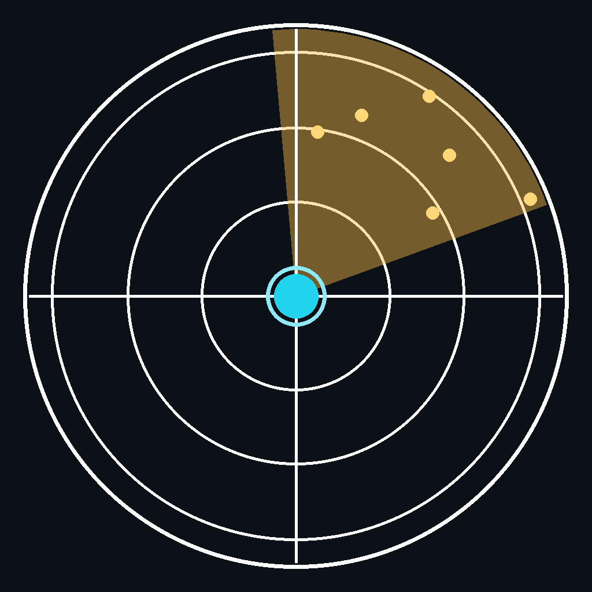
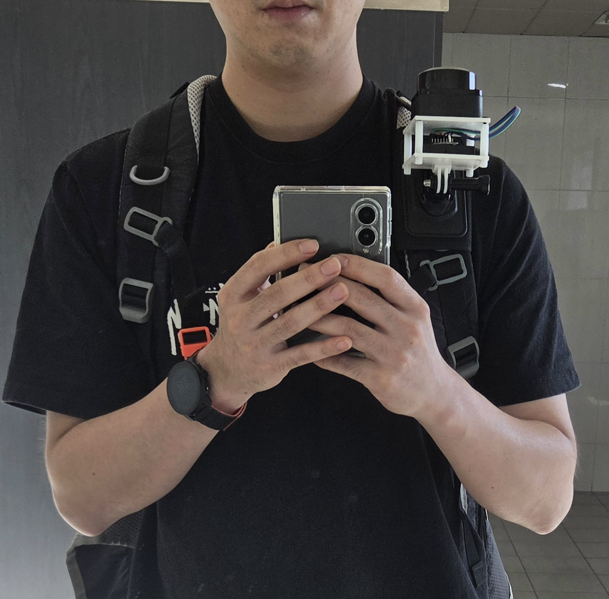
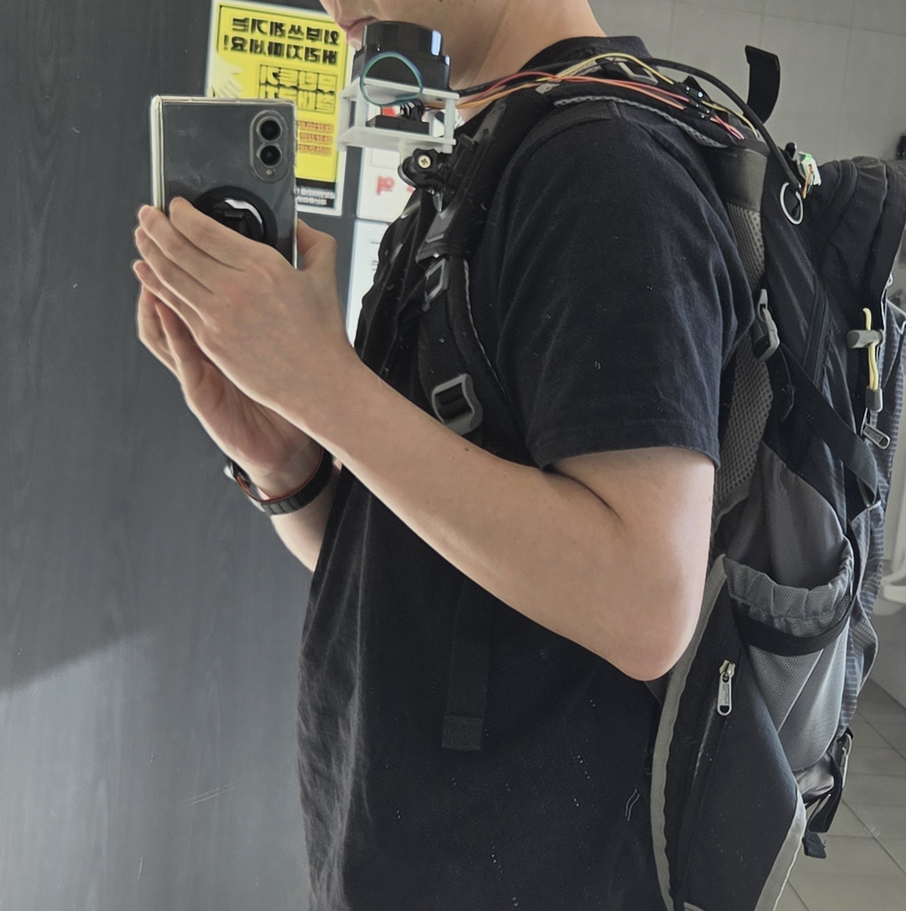

  

<h1 align="center">LidarMapper</h1>

백팩을 메고 걷기만 하면, 그 공간이 지도가 됩니다.

---

## 이게 뭔가요?

**Portable LiDAR Mapper**는 라이다 센서를 백팩 어깨끈에 달고 다니면서, 실내
공간(집·사무실 등)을 걷는 것만으로 2D 지도를 자동으로 그려주는 개인용
프로젝트입니다. 로봇청소기가 집 구조를 스스로 파악하는 것과 같은 원리를,
사람이 직접 메고 다니는 방식으로 구현했습니다.

- **하드웨어**: RPLIDAR C1(라이다 센서) + Orange Pi 4 Pro(소형 컴퓨터)를
  어깨끈에 장착
- **동작 방식**: 걸어 다니면 라이다가 주변까지의 거리를 초당 수천 번 측정하고,
  SLAM(동시 위치추정 및 지도작성) 알고리즘이 그 데이터를 실시간으로 하나의
  지도로 이어붙입니다
- **이 앱(LidarMapper)의 역할**: 그 장비와 와이파이로 통신해서, 폰 화면에서
  실시간 스캔 상태를 레이더처럼 보고, 완성돼 가는 지도를 확인하고, 원할 때
  저장하는 컨트롤러/뷰어입니다

  
  

실제 조립/착용 사진 (2026-09-30~10-01 필드 테스트)

## 이 저장소는 무엇인가요?

이 저장소는 **소스 코드가 아니라 완성된 앱(APK) 배포 전용**입니다. 실제
개발은 별도의 비공개 저장소에서 진행되고, 커밋될 때마다 GitHub Actions가
자동으로 앱을 빌드해서 여기 [Releases](../../releases/latest)에 최신 APK를
올려둡니다. 앱 안의 **설정 → 업데이트 확인** 메뉴가 바로 이 저장소를 확인해서
새 버전을 받아옵니다.

## 설치 방법

1. [Releases 페이지](../../releases/latest)에서 `app-release.apk` 다운로드
2. 안드로이드에서 "출처를 알 수 없는 앱 설치" 허용 후 설치
3. 이후부터는 앱 안에서 **설정 → 업데이트 확인**으로 최신 버전 유지

---

## 앱 버전 히스토리

<!--
새 빌드를 릴리스할 때마다 위쪽에 새 항목을 추가해주세요.
형식: ## vX.Y.Z — YYYY-MM-DD — 한줄 요약
(버전 번호는 app/lidar_mapper_app/pubspec.yaml의 version 필드 기준)
-->

### v0.2.7 — 2026-10-20 — 드리프트 진단 도구 3종 + 나침반 버그 수정
- **홈 · IMU 카드**: BNO055 자체 캘리브레이션 상태(SYS/자이로/가속도/지자기) 표시,
  미보정 시 보정 방법 안내
- **트래킹 화면**: 진단용 rosbag 녹화 토글(파라미터 튜닝 비교용 원본 데이터 저장),
  나침반이 제자리 회전에도 안 움직이던 버그 수정 + 스캔/지도 화면과 안 겹치게 위치 분리
- **장소 생성**: 폰 GPS로 실외 장소에 좌표 자동 기록
- **홈 · 라이다 카드**: 전원 켜기/끄기·스캔 속도(Hz) 조절을 설정 탭에서 이쪽으로 이동,
  전원 끄기가 실제로 모터를 안 멈추던 버그 수정

### v0.2.3 — 2026-10-02 — 배터리/네트워크 실시간 상태 + 지도 품질 개선
- **홈**: 콘센트 전원 연결 시 아이콘 전환, 네트워크 카드에 실제 접속 SSID 표시
- 누적 지도 해상도 2배 상향, 렌더링 선명도 개선, 노이즈/축적 속도 파라미터 튜닝
- 앱 버전을 업데이트 화면에 표시(커밋 해시 대신 읽을 수 있는 버전 번호)

### v0.2.0 — 2026-10-02 — 매핑 시작/중지/일시정지/클리어
- 트래킹 화면에 세션 제어 버튼 추가 — 시작 시점을 깨끗한 원점으로 리셋,
  지도가 이상하면 클리어, 매핑 안 할 때는 중지해서 배터리 절약

### v0.1.1 — 네비게이션 버그 수정 + 나침반 UX 개선
- 하단 탭 재탭/뒤로가기 시 화면이 꼬이던 버그 수정
- 실시간 스캔 화면에 나침반(N/E/S/W) 및 진행 방향 화살표 추가

### v0.0.1 — 2026-09-22 — 첫 공개 빌드
- 4탭 구조(홈/트래킹/목록/설정) 기본 골격
- **홈**: 라이다·IMU·Orange Pi·배터리·네트워크·전원 상태 진단 카드
- **트래킹**: 실시간 라이다 스캔 레이더 뷰 + 누적 지도(핀치줌, 1m 격자,
  색상 테마 선택, 스캔된 자유공간 부채꼴 표시), 지도 저장 기능
- **목록**: 저장된 세션 조회
- **설정**: 지도 색상/격자선 커스터마이징, 앱 내 업데이트 확인
- rosbridge(WebSocket)로 Orange Pi와 통신, 연결 끊김 시 자동 재연결
